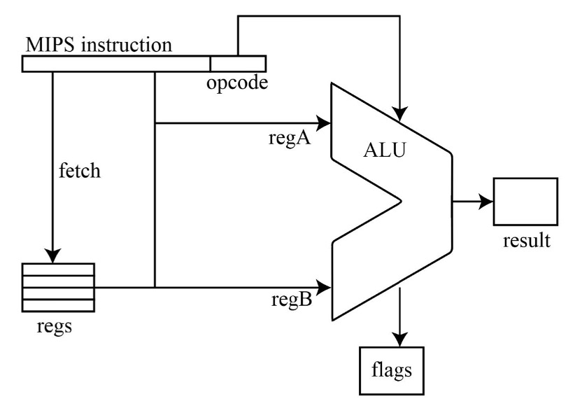
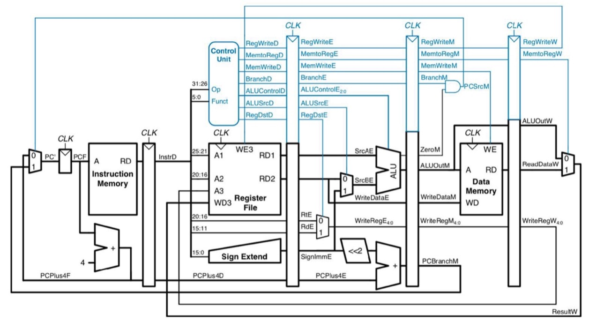
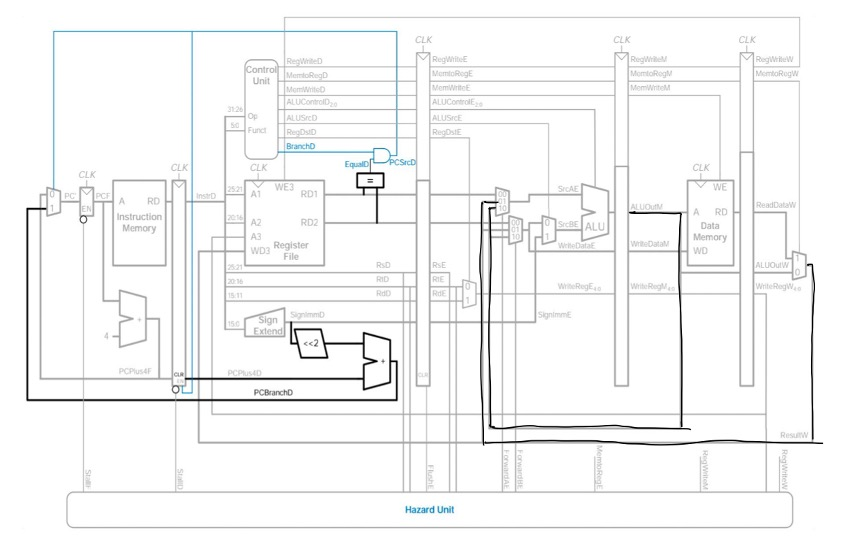

# 5-Stage Pipelined MIPS CPU and ALU

Course project for **CSC3050: Computer Architecture, Spring 2022** at **The Chinese University of Hong Kong, Shenzhen**.

The assignment has two parts. The first is a standalone ALU that executes one MIPS instruction from two register values and reports status flags. The second is a classic five-stage pipeline CPU that uses that ALU in the execute stage and handles data and control hazards. The figures in [section 2](#2-what-the-project-does) show those two blocks and the hazard logic added on top. The full assignment statement is in [`docs/project requirements.pdf`](docs/project%20requirements.pdf). Design notes and the reported test status are in [`docs/Report for CSC3050 Project 3.pdf`](docs/Report%20for%20CSC3050%20Project%203.pdf).

Simulation uses [Icarus Verilog](https://steveicarus.github.io/iverilog/) (`iverilog` and `vvp`).

## 1. Repository layout

```
docs/                     Assignment, project report, and datapath figures
src/alu/                  Standalone ALU and its testbench
src/cpu/                  Pipelined CPU
testcase/alu_test/        Place for extra ALU test data
testcase/cpu_test/        MIPS programs, machine code, and expected data-memory dumps
```

`src/cpu/InstructionRAM.v` and `src/cpu/MainMemory.v` are course-provided memory modules. The CPU loads its program from `instructions.bin` in `src/cpu/`.

## 2. What the project does

### 2.1 Standalone ALU



One instruction and two register values enter the ALU. It returns a 32-bit result and three flags: zero, negative, and overflow.

`src/alu/alu.v` is the first deliverable. It is not yet connected to a register file or a pipeline.

| Port | Meaning |
| --- | --- |
| `instruction[31:0]` | One MIPS instruction |
| `regA[31:0]` | Value of the register whose address is `00000` |
| `regB[31:0]` | Value of the register whose address is `00001` |
| `result[31:0]` | ALU result. For `lw` and `sw` this is the effective address |
| `flags[2:0]` | `flags[2]` zero, `flags[1]` negative, `flags[0]` overflow |

Only those two register addresses appear in the `rs` and `rt` fields. The module decodes the instruction and feeds `regA` or `regB` into the correct operand. Signed `add` and `sub` set the overflow flag. Comparisons set the negative flag when the condition is true, and `beq` / `bne` set the zero flag when the two operands are equal.

### 2.2 Five-stage pipeline



Each instruction passes through fetch, decode, execute, memory, and write-back. The ALU from the first part sits in the execute stage, and the control signals for an instruction move forward with it. In this drawing a branch is still decided in the memory stage. The CPU in this repository decides it in decode, as the next figure shows.

`src/cpu/cpu.v` is a MIPS pipeline. Pipeline registers between the stages are in `src/cpu/pipeline_registers.v`.

1. **IF** fetches the instruction addressed by the PC from instruction memory, then selects the next PC: `PC+4`, a branch target, a jump target, or the register value used by `jr`.
2. **ID** decodes the instruction in `control_unit.v`, reads the 32-entry register file, sign- or zero-extends the immediate, and compares the two branch operands.
3. **EX** runs `src/cpu/alu.v`. Multiplexers choose a register value, a shift amount, or an immediate for each ALU input, and choose `rt` or `rd` as the destination register.
4. **MEM** reads or writes data memory. `lw` and `sw` use the address computed in EX.
5. **WB** writes the ALU result or the loaded memory word back to the register file.

### 2.3 Hazards



The hazard unit along the bottom is what this CPU adds to the pipeline above. It forwards a result that is still in the pipeline, inserts a one-cycle stall when the next instruction needs a value just loaded from memory, and resolves a branch in decode so the instruction fetched behind it can be discarded.

The CPU includes the three hazard mechanisms described in the report. The report states that test cases 1, 2, and 4 pass. The later hazard cases are implemented, and the report notes that some of them may still be incorrect.

1. **Forwarding.** An ALU input can take the result from the MEM stage or the WB stage instead of the stale register-file value. If both are available, the newer MEM result is used.
2. **Stalling.** A load-use hazard freezes the PC for one cycle and inserts a bubble into the ID/EX register.
3. **Control hazards.** Branches are resolved in ID. A taken branch or jump flushes the instruction that was fetched in the same cycle.

## 3. How to run

Install Icarus Verilog, then run the commands below from the repository root. `src/cpu/makefile` and `src/alu/makefile` wrap the same `iverilog` / `vvp` flow. On a case-sensitive filesystem, compile the ALU with the lowercase filenames shown below.

### 3.1 ALU

```bash
cd src/alu
iverilog -o alu alu.v test_alu.v
vvp alu
```

Each case prints the instruction, operands, result, and flags, followed by `PASS` or `WRONG`. The bench finishes on its own. The vectors are written in `src/alu/test_alu.v`. `testcase/alu_test/` is an empty place for additional ALU vectors.

### 3.2 CPU

Instruction memory is initialized from `src/cpu/instructions.bin` (`$readmemb`). Copy one of the provided machine-code files there, then simulate. Run the simulator from `src/cpu`, because the memory module opens `instructions.bin` by that relative name.

```bash
cd src/cpu
cp ../../testcase/cpu_test/machine_code1.txt instructions.bin
iverilog -o cpu.vvp test_cpu.v
vvp cpu.vvp
```

`test_cpu.v` only supplies a clock. The CPU itself stops when the instruction in the ID stage is `0xFFFFFFFF` (the word of all ones at the end of each machine-code file). It then waits five more cycles so the last instructions can leave the pipeline, prints all 512 data-memory words, and writes the same dump to `src/cpu/data.bin`. Fetched instructions are also logged to `src/cpu/command.bin`.

Compare the dump with the expected memory for that program. For machine code 1, the reference file is `testcase/cpu_test/DATA_RAM1.txt`. Repeat the copy step with `machine_code2.txt` through `machine_code8.txt` to run the other programs.

### 3.3 CPU test programs

Each `mipsN.asm` file is the source for `machine_codeN.txt`. `DATA_RAMN.txt` is the expected data-memory image after that program. `testcase/cpu_test/About test.pdf` describes how the samples are constructed: extra instructions are inserted so that each file stresses one hazard.

| Program | What it checks |
| --- | --- |
| 1 | Arithmetic, logic, shift, `lw`, and `sw`, with results stored to data memory |
| 2 | Forwarding from MEM to EX and from WB to EX |
| 3 | The one-cycle stall after `lw` when the next instruction uses the loaded register |
| 4 | A register-file read in the same cycle as a write-back to that register |
| 5 | `beq` and `bne` |
| 6 | `j` and `jal` |
| 7 | A data hazard on `jr` |
| 8 | A data hazard on `beq` and `bne` |

## 4. Supported instructions

The CPU control unit recognizes this subset:

| Type | Instructions |
| --- | --- |
| R-type | `add`, `addu`, `sub`, `subu`, `and`, `or`, `nor`, `xor`, `slt`, `sll`, `srl`, `sra`, `sllv`, `srlv`, `srav`, `jr` |
| I-type | `addi`, `addiu`, `andi`, `ori`, `xori`, `beq`, `bne`, `lw`, `sw` |
| J-type | `j`, `jal` |

The standalone ALU testbench also checks `slti`, `sltiu`, and `sltu`. Those three are not decoded by the CPU control unit.
